<div align="center">

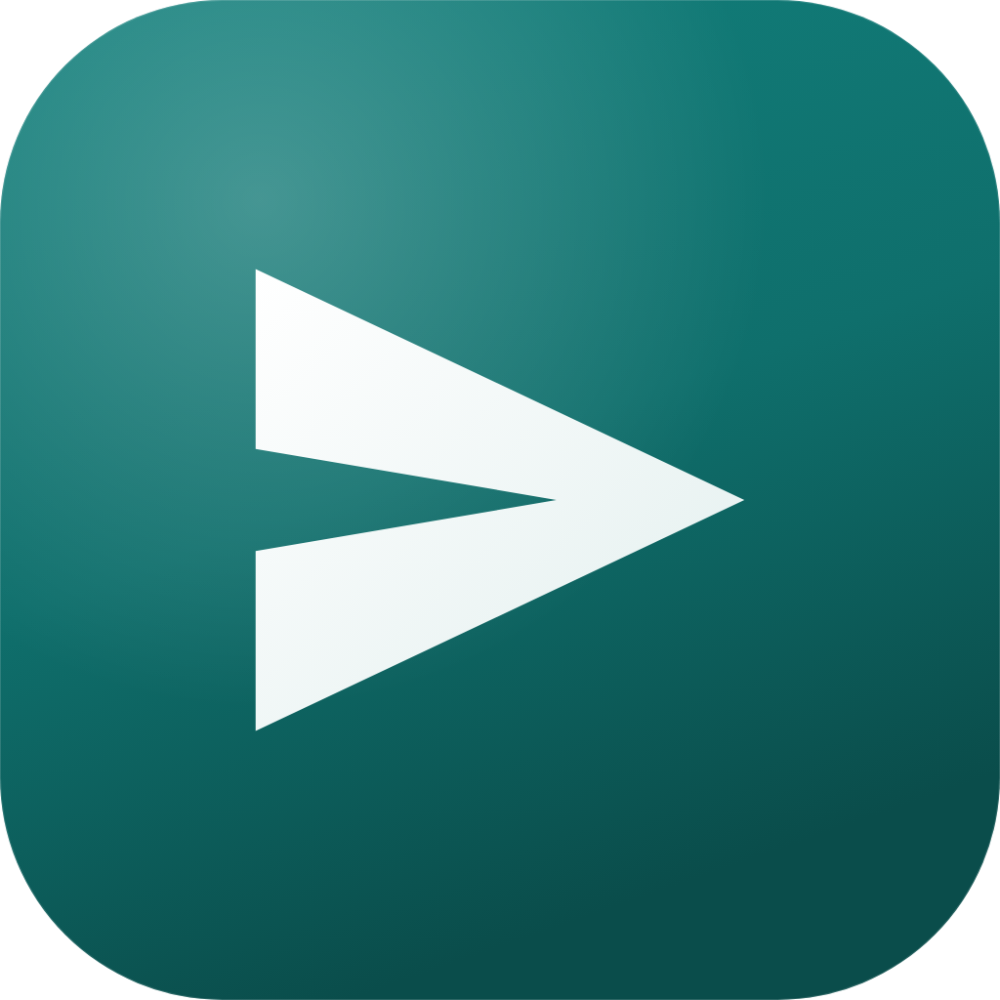

# 小投 · JobCourier

**BOSS 直聘智能投递助手（个人自用修改版）**

按设定的求职方向自动筛选岗位，用 AI 对比简历判断匹配度，只把简历投给合适的公司。

全程在本机运行，岗位记录、简历、API Key 都留在你自己的电脑上。

</div>

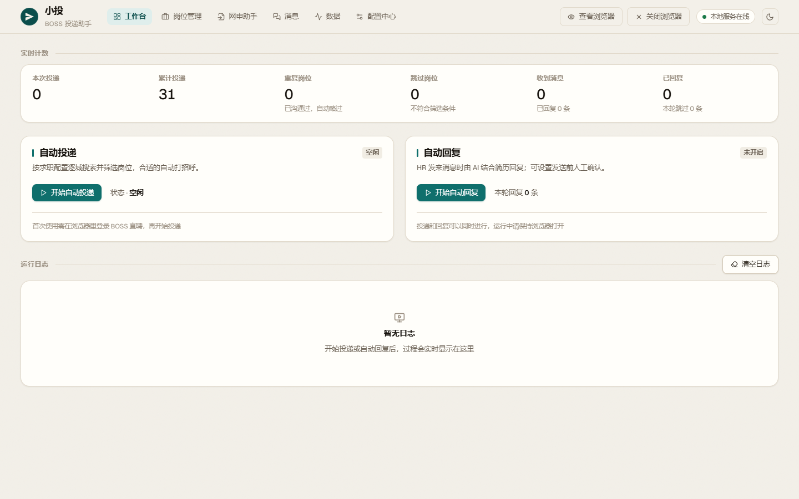

> **关于这个项目**：这是一个面向个人求职场景的本地自用工具，按自己的实际需求逐步打磨而成，现已开源到 GitHub（[KecaiFan/JobCourier](https://github.com/KecaiFan/JobCourier)），欢迎 Star、提 Issue 和 PR。项目没有演示视频，下面写的内容都以本目录里的实际代码为准。

## 这是什么

**小投**（英文名 **JobCourier**）是一个跑在你自己电脑上的 BOSS 直聘投递助手：

- 后端 FastAPI（Python 3.12），前端 React 19 + TypeScript + Vite，浏览器自动化用 [Patchright](https://github.com/Kaliiiiiiiiii-Vinyzu/patchright)，AI 能力基于 [Pydantic AI](https://ai.pydantic.dev)
- 前端构建产物由后端在 **8000 端口**一并伺服，前后端同源、只有一个端口，浏览器打开 http://127.0.0.1:8000 即可
- 岗位记录、简历、API Key、Chrome 登录态全部保存在本机 `user_data/`，不上传到任何服务器
- 界面以「投」为线索：靛青纸飞机图标，日间「纸与墨」、夜间「星港」两套主题，顶栏右上角一键切换
- 命名约定：正文一律用中文名「小投」，脚本与数据文件沿用英文名，如 `start-jobcourier.cmd`、`job-courier.db`、环境变量 `JOB_COURIER_DATA_DIR`

## 主要功能

每天刷几百个岗位、逐个点开看职责、再挨个点「立即沟通」，这些重复劳动交给小投就好。

- **自动投递**：按你的求职条件逐个查看岗位，符合条件就替你向 HR 打招呼，全程无需守在电脑前
- **关键词与城市轮换**：每个岗位关键词依次跑你选的城市；单个关键词每轮最多投 10 个岗位，投满就换下一个关键词，全部轮完还没到当日额度就从头再来一轮。已看完的「关键词 × 城市」组合会记录断点，下次启动自动跳过，不用重头再刷
- **AI 岗位复核**：AI 逐个读岗位职责，识别骗子岗位，并按「核心职责匹配 / 可迁移证据 / 硬性要求 / 工具与技术栈 / 实际条件」五个维度打分，判断描述和匹配度都记在岗位库里
- **骗子岗位识别**：AI 识别刷单、培训收费、拉人头、只收简历不招人等岗位，识别到直接跳过，不浪费沟通次数
- **简历技术匹配**：上传简历后，AI 对比岗位技术要求与你的技能，给出 0 到 100 分的匹配度；技术栈对不上的直接跳过
- **匹配度过滤**：只投递匹配度达标的岗位，把每天有限的沟通次数花在刀刃上
- **高分岗位自动定制简历**：AI 评分达到分数线的岗位，后台自动按岗位生成定制简历，在岗位详情里查看与导出
- **像真人一样投递**：随机停顿、分批休息，每天节奏略有不同；HR 消息延迟回复、按时段工作，降低账号风险
- **AI 自动回复**：HR 发来消息时，AI 结合你的简历和岗位信息回复，HR 索要简历时自动发送附件简历；可选择「发送前人工确认」，先审后发
- **消息记录与沟通状态**：和 HR 的聊天按会话集中查看，AI 自动回复的消息单独标注；AI 识别到面试邀请会自动标「有面试」，HR 拒绝、AI 婉拒也会自动标记，面试后还能手动标记结果并按状态筛选
- **跟进提醒**：你发出消息后 HR 超过设定小时数没回，会话自动标「待跟进」，不用自己盯着
- **网申助手**：不少公司在 BOSS 上不挂 HR，简历发不过去，只能去企业官网填表投递。把官网表单页地址交给网申助手，它扫出表单字段、按你的「网申资料」自动代填，提交按钮永远留给你自己点
- **查企业**：一键读取公司的工商信息，上网搜索欠薪、裁员、失信等负面信息，AI 给出低 / 中 / 高风险评估和依据，风险标签直接显示在岗位和会话列表里
- **黑名单**：公司名或岗位关键词命中黑名单一律跳过；查企业判为高风险的公司会自动进榜
- **数据导出**：岗位和聊天记录都能一键导出为 JSON，方便整理、复盘或交给其他工具处理
- **数据只在本机**：岗位记录、简历、API Key 全部保存在你自己的电脑上

## 快速开始

### 1. 准备环境

装好这三样即可，都是一次性的：

1. **Python 3.12**，用 [uv](https://docs.astral.sh/uv/) 管理（不建议用官网安装包装的 Python，容易和环境变量冲突）
2. **Node.js 22+**（自带 npm，用于构建前端）
3. **Google Chrome**（自动投递通过本机 Chrome 完成）

另外准备一个大模型 API Key，推荐 [DeepSeek](https://platform.deepseek.com/api_keys)；也可以用通义千问、Kimi、智谱、OpenAI 等任意 OpenAI 兼容服务，或本地 Ollama。

### 2. 一键启动（Windows 推荐）

把整个项目文件夹放在本机，进入该目录后运行启动脚本：

```powershell
cd <项目所在目录>
.\start-jobcourier.cmd
```

首次运行脚本会自动补齐环境，无需手动操作：

- `uv sync`：安装后端依赖，生成 `.venv`
- `npm ci`：安装前端依赖
- `npm run build`：构建前端到 `frontend/dist/`

依赖就绪后启动服务，并在服务可用后自动打开浏览器。以后每次启动只要再跑一次 `.\start-jobcourier.cmd` 即可。项目根目录的 `run.txt` 里也放了同样一份简明说明。

### 3. 手动分步启动（可选，方便排查）

macOS / Linux 或想自己控制每一步时：

```bash
uv sync                     # 安装后端依赖

cd frontend
npm ci
npm run build               # 构建前端到 frontend/dist/

cd ..
uv run python -m job        # 启动本地服务（自动打开浏览器）
uv run pytest -q            # 运行测试
```

改动 `frontend/` 下的界面代码后需要重新执行 `npm run build` 才会生效；只改后端 `job/` 时直接重启服务即可。

### 4. 访问、自检与停止

- 浏览器访问 **http://127.0.0.1:8000**（前后端同源，只有这一个端口）
- 就绪自检：`curl http://127.0.0.1:8000/ping` 返回 `{"ok":true}` 即正常
- 停止：在运行窗口按 `Ctrl+C`

## 使用流程

### 第一步：开通 AI 服务

打开 **配置中心 → 系统设置 → 大模型服务**：

1. 接口地址：使用 DeepSeek 时留空即可；使用其他服务时填写它的 OpenAI 兼容地址，例如本地 Ollama 填 `http://localhost:11434/v1`
2. 粘贴对应服务的 API Key（本地 Ollama 可随意填写）
3. 点击「获取模型列表」，选择一个模型
4. 点击「测试连接」，看到连接成功即可

API Key 只保存在本机数据库中，不会上传到任何服务器。

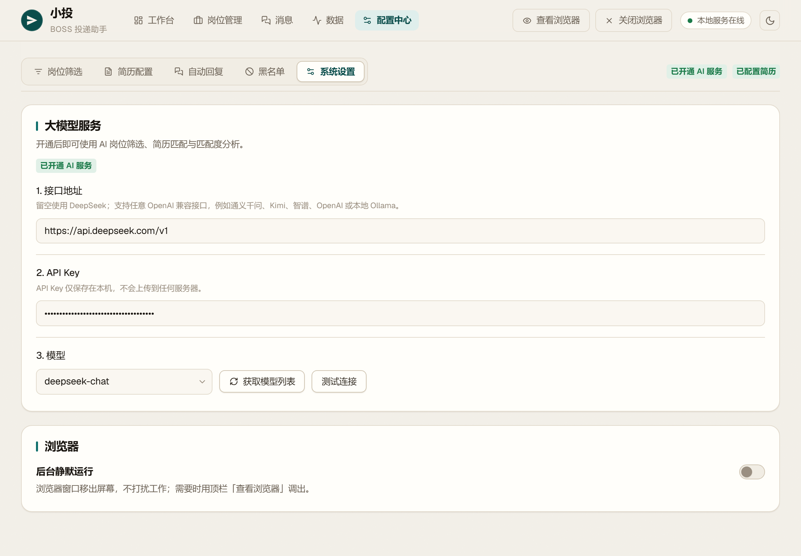

### 第二步：设置求职条件

打开 **配置中心 → 岗位筛选**，告诉小投你想找什么工作：

- **基础条件**：岗位关键词（可点「AI 生成」让 AI 帮忙拟关键词，每个关键词单独跑一轮搜索）、目标城市（多选，按投递优先级排序）、求职类型、薪资范围、期望月薪
- **经验 / 学历 / 公司**：工作经验、最低学历、融资阶段、企业规模
- **投递节奏**：慢速 / 正常 / 快速，或自定义看一条、翻页、每投几条歇一次的停顿
- **岗位质量把关**：骗子岗位识别、简历技术匹配、匹配度过滤、高分岗位自动定制简历（详见下一节）

所有修改自动保存。目标城市按选择的顺序依次投递，比如选了「广州、深圳」，会先跑广州的岗位，再看深圳。

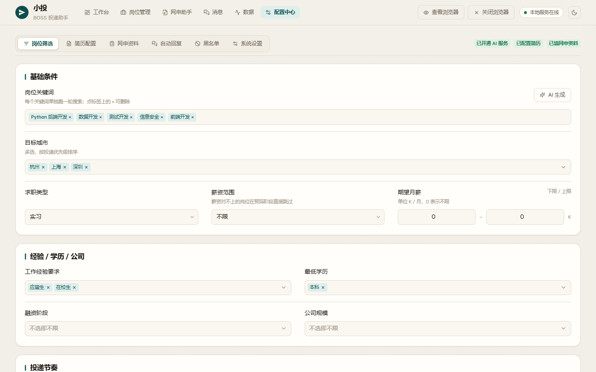

#### 岗位质量把关

- **骗子岗位识别**：AI 识别刷单、培训收费、拉人头、只收简历不招人等岗位，识别到直接跳过
- **简历技术匹配**：投递前由 AI 对比岗位要求与你的技能，只投技术对口的岗位，并在岗位列表显示匹配度
- **匹配度过滤**：打开后设置「最低匹配度」（默认 60），低于这个分数的岗位不投；需要先开启简历技术匹配
- **高分岗位自动定制简历**：开启后设置「分数线」（默认 80），AI 评分达到分数线的岗位会在后台自动生成定制简历，可在岗位详情里查看与导出

AI 评分采用「模型给分项、程序做决定」：大模型只输出各维度的分数与原文证据、缺失的硬性要求，总分由程序求和并按规则封顶，是否投递也由程序判定，避免模型算错数、虚高分或一票否决。五个维度分别是核心职责匹配、可迁移证据、硬性要求、工具与技术栈、实际条件，明细可以在岗位详情里查看。

### 第三步：上传简历

切到 **配置中心 → 简历配置**：

1. 点击「上传简历」选择文件（支持 PDF / Word / 图片），内容会自动识别
2. 识别结果会填进「简历内容」，可以直接粘贴或修改；AI 匹配与自动回复都以这里的文字为准

简历内容越完整，匹配越准。上传后可以检查一下识别出来的文字，缺的技能、项目经历直接补上。

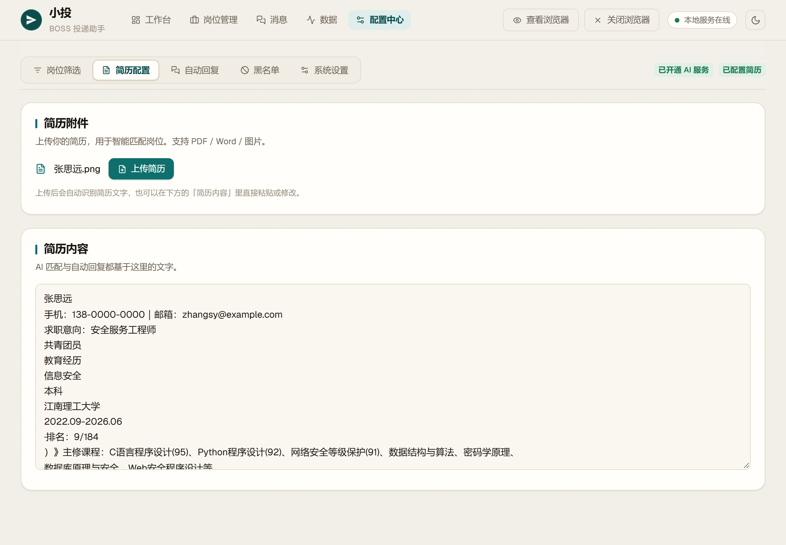

### 第四步：开始自动投递

回到 **工作台**，点击「开始自动投递」：

1. 首次使用会打开 Chrome，请在里面登录 BOSS 直聘，登录一次即可长期保持
2. 小投会按求职条件逐个查看岗位，符合条件的自动点击「立即沟通」；确实需要你手动处理的岗位会标记「待手动投递」，在岗位管理里可以打开 BOSS 页面或直接标记为已投递
3. 运行日志实时显示每个岗位的处理结果；投递开始后按钮会变成「停止投递」，随时可以点击结束

所有关键词和城市都轮完，或当天投递满 150 次，会自动停止，第二天可以继续。

### 第五步：查看与分析岗位

打开 **岗位管理** 查看所有看过的岗位，合适的和不合适的都会记录下来：

- 每个岗位都有「是否合适」和「判断描述」，比如「外包公司」「技术栈吻合」，鼠标移到描述上可查看完整内容
- 按分析状态（全部 / 已分析 / 未分析 / 高匹配）和合适与否（全部 / 合适 / 不合适）筛选，也可以直接搜索岗位或公司
- 勾选岗位后点击「AI 分析」，按当前配置和简历重新判断是否合适，并更新匹配度
- 查看岗位详情（评分明细、缺失要求、工作地址、岗位描述），为高分岗位查看或导出定制简历，或批量删除不需要的记录
- 点击操作列的「查企业」，读取 BOSS 公司主页的工商信息（企业全称、法人、注册资本、成立时间、经营状态等），用公司全称上网搜索欠薪、裁员、失信被执行等负面信息，再由 AI 综合评估为低风险、中风险、高风险或信息不足，并列出依据和来源链接。结果按公司保存，公司名旁显示风险标签，下次打开直接查看，点「重新查询」可刷新；判为高风险的公司会自动加入黑名单。没有配置 AI 服务时只展示工商信息和搜索结果
- 点击「导出全部」把所有岗位导出为 JSON；勾选岗位后点击「导出选中」，只导出勾选的岗位

打开 **数据** 查看投递与沟通统计：投递率、面试率、HR 响应中位时长，以及投递漏斗、最近 14 天的每日投递量、各沟通状态的会话分布和评分校准表。

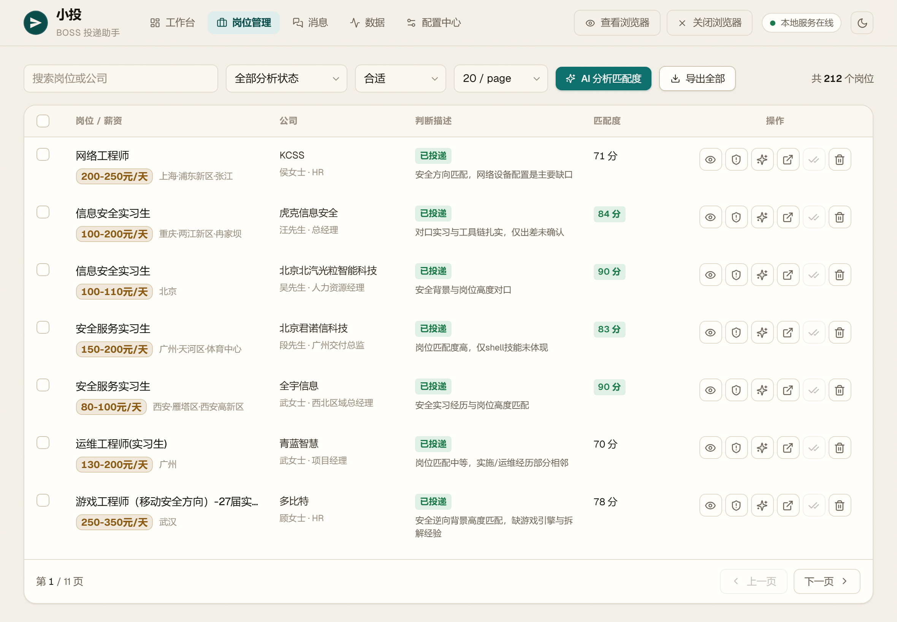

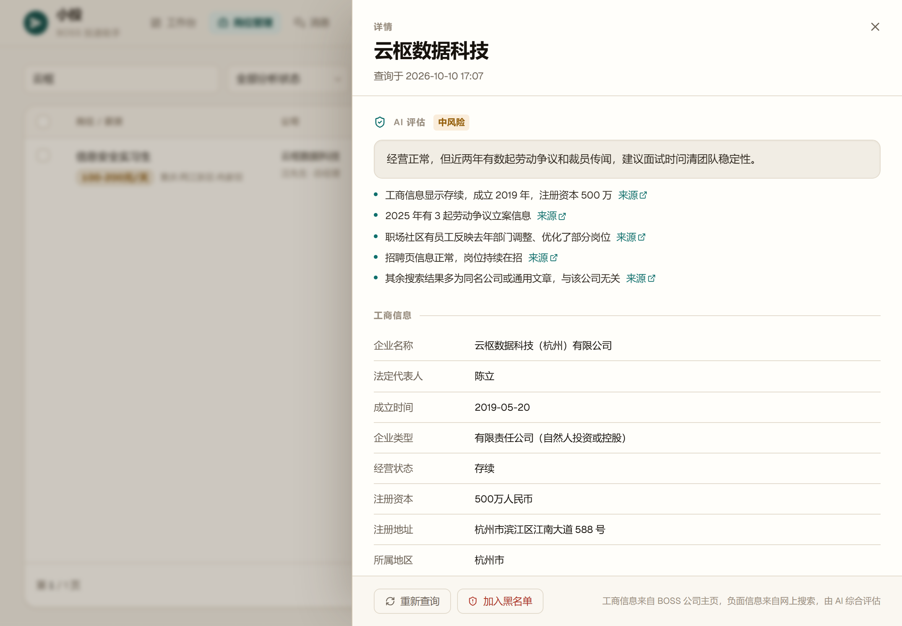

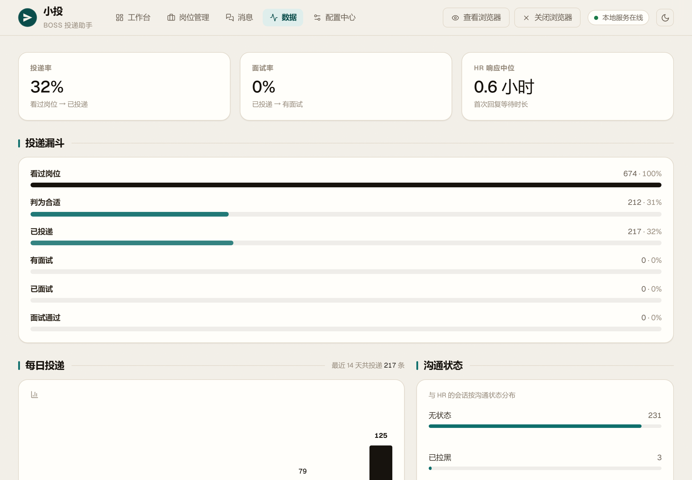

### 第六步：自动回复 HR 消息

1. 打开 **配置中心 → 自动回复**，开启「启用自动回复」（需要先开通 AI 服务并配置简历；想让 HR 要简历时自动发送，还要在 BOSS 直聘上传附件简历）
2. 按需修改「回复提示词」，比如语气、薪资怎么回答、到岗时间（可参考下方的模板）
3. 在「回复策略」里决定是否「发送前人工确认」（开启后回复会先等你点同意）、是否自动拉黑主动联系的 HR、以及跟进提醒的小时数
4. 在最下方的「回复节奏」选择慢速 / 正常 / 快速，或自定义回复时段、每条回复前的等待时间和休息间隔；不在回复时段收到的消息，会顺延到下一个时段再回
5. 回到 **工作台**，点击「开始自动回复」，可以和自动投递同时运行；需要结束时点击「停止回复」

#### 回复提示词模板

AI 回复时会参考你的简历、沟通的岗位、岗位是否合适的判断和最近的聊天记录，提示词只需要写清楚「怎么回」。下面是一份可以直接参考的模板，按自己的情况修改即可：

```text
你是正在求职的我，在 BOSS 直聘上和 HR 沟通。请根据我的简历回复 HR 的最新消息。
一切以我的利益为最高原则：不为了迎合 HR 让步，不轻易答应对我不利的条件。

基本要求：
* 语气礼貌、真诚、口语化，像真人聊天，每次回复不超过 80 字
* 只根据简历里的真实经历回答，不编造经历、技能、证书和学历
* 不重复打招呼，不用表情符号，不说「作为 AI」之类的话

常见问题怎么回：
* 索要简历：简短回应即可，如「好的，简历发您了，请查收」，程序会自动发送附件简历
* 问薪资：期望 16K～20K/月，可根据岗位职责和整体待遇再沟通
* 问到岗时间：离职后一周内可到岗
* 问简历里没有的技能或经历：如实说明没有相关经验，可以补充相近的经历
* 问学历、证书等硬性条件：如实回答，不回避

面试方式（第一轮优先线上）：
* 问能否面试：表示可以，希望第一轮先线上面试（视频或电话），请对方告知时间
* 约线下面试（如「什么时候方便过来面试」）：先礼貌询问第一轮能否改为线上，给一个合理的理由，
  并表示第二轮可以到公司面谈。理由要符合简历里的真实情况：简历显示仍在职，可以说「目前还在职，
  白天不方便请假」；已离职，可以说「近期面试安排比较密集」；距离较远，可以说「往返需要半天」
* 第二轮及之后的面试：可以接受线下，请对方告知时间和地址
* HR 坚持第一轮必须线下：礼貌婉拒，感谢对方，表示如果之后可以线上沟通再联系

岗位不合适时：
* 岗位判断为不合适，或是外包、驻场、派遣、与目标方向无关的岗位，礼貌说明方向不一致并感谢对方，不再追问细节
* HR 明确表示不合适或岗位已招满时，不用回复
```

「面试方式」这一段让第一轮先线上面试，避免 HR 只是为了完成邀约 KPI 让你白跑一趟，确认对方有诚意后第二轮再去线下；不需要的话删掉即可。「岗位不合适时」这一段和「HR 坚持第一轮必须线下」决定 AI 什么时候替你婉拒，婉拒后会话会被标记，见下文。

#### 自动发送简历

HR 索要简历时（如「方便发份简历吗」），AI 先回复一句，再自动点击聊天窗口里的「发简历」并确认，发送你在 BOSS 直聘上传的附件简历。聊天里出现「附件简历请求已发送」即为发出，运行日志会显示「已发送附件简历请求」。双方还没互动、按钮不可用，或者还没上传附件简历时，运行日志会提示你手动发送。

注意：发送的是你在 BOSS 直聘上传的附件简历，不是配置中心里上传的那份（那份只给 AI 参考回复用）。

#### 沟通状态与跟进提醒

每个会话有一个沟通状态，AI 回复时会自动更新：

- HR 明确表示不合适（如「暂不匹配」「岗位已招满」）时不会再回复，标记为「HR 已拒绝」；岗位不合适、AI 已替你婉拒的标记为「AI 已婉拒」。之后 HR 再发来新消息，AI 会重新判断要不要继续沟通，继续沟通时会清掉这个标记
- HR 发出面试邀请，或者正在和你约面试时间、地点、方式时，标记为「有面试」，运行日志会显示「识别到面试邀请，已标记有面试」；只是介绍面试流程（如「我们是线下面试」）不算
- 面试之后可以手动标记「已面试」「面试通过」或「面试不通过」，这三种状态 AI 不会改动；「面试不通过」和「HR 已拒绝」「AI 已婉拒」一样，HR 没有新消息时不再回复
- 你发出消息后 HR 超过设定小时数没回，会话自动标「待跟进」
- 开启「自动拉黑主动联系的 HR」后，岗位不在你投递库中的会话会被视为 HR 主动联系，自动拉黑该公司并禁止回复

打开 **消息** 可以查看和每位 HR 的聊天记录：

- 左侧是会话列表，支持按 HR、公司或岗位搜索；每个会话显示沟通状态标签，有面试、面试通过为绿色，面试不通过、HR 已拒绝为红色，已面试为蓝色，AI 已婉拒为灰色
- 用搜索框旁的筛选按钮可以只看某一种沟通状态：全部、无状态、所有面试、待跟进，或某一种具体状态
- 右侧是聊天内容和沟通的职位，AI 自动回复的消息会单独标注；右上角的「沟通状态」下拉可以手动修改当前会话的状态，选「无」即清除
- 开启「发送前人工确认」后，待发送的回复会显示在这里，点「同意发送」或「放弃」
- 会话顶部点击「查企业」，查看这家公司的工商信息、网上负面信息和 AI 风险评估，与岗位管理里的查企业共用结果；查过的公司在会话列表里显示风险标签
- 点击「导出会话」导出当前会话，或导出全部会话为 JSON，每个会话包含 HR、公司、岗位、沟通状态和完整的聊天记录

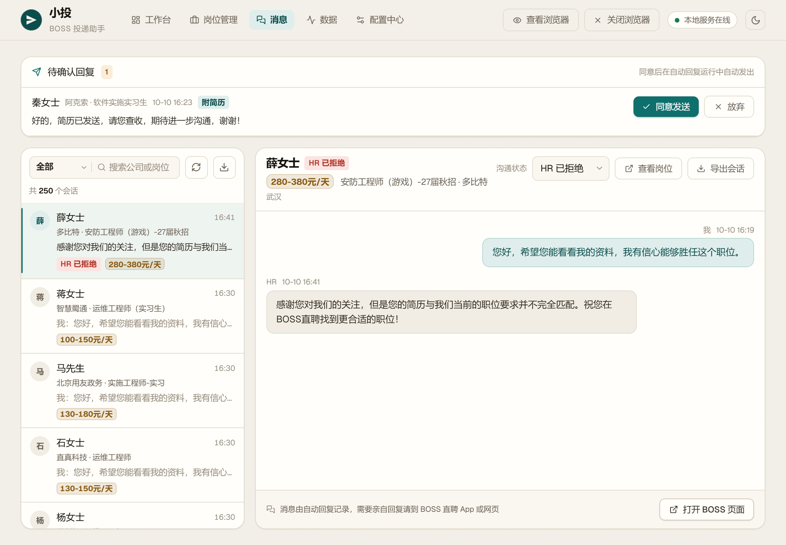

### 第七步：网申投递

不少公司在 BOSS 上不挂 HR，简历发不过去，只能去企业官网的投递表单里再填一遍。网申助手把「填表」这一步接管下来：

1. 先到 **配置中心 → 网申资料** 把姓名、手机号、邮箱、毕业学校、专业这些常用信息填好，也可以加自己的补充字段（比如「英语等级」「政治面貌」）；填过姓名和手机号或邮箱后，顶栏会显示「已填网申资料」
2. 打开 **网申助手**，点「新建网申任务」，从岗位库里挑一个岗位，把这家企业官网的投递表单页地址粘进去
3. 点「扫描表单」，程序打开这个页面，把表单里的输入框、下拉、单选框读成一张对照表，并按「网申资料」自动对上每一项；对不上或对错的可以在表里手动改，每项都会标出内容来源（资料 / 简历 / 沿用 / AI / 手动）
4. 核对无误后点「填入浏览器」，程序把内容代填进页面；遇到验证码、滑块之类需要人处理的东西会提示你先处理
5. 最后一步交给你：切到浏览器里检查一遍，**自己点提交**。表单提交不可撤回、还常带验证码，所以这个按钮永远留给你
6. 提交完回到网申助手点「标记已提交」，任务状态会从「待网申」「已填表」变成「已提交」；不需要的记录可以随时删除

任务可以按状态筛选（全部 / 待网申 / 已填表 / 已提交 / 需人工）。「需人工」是扫描或填表时遇到验证码、字段读不懂等情况，需要你自己上浏览器处理。

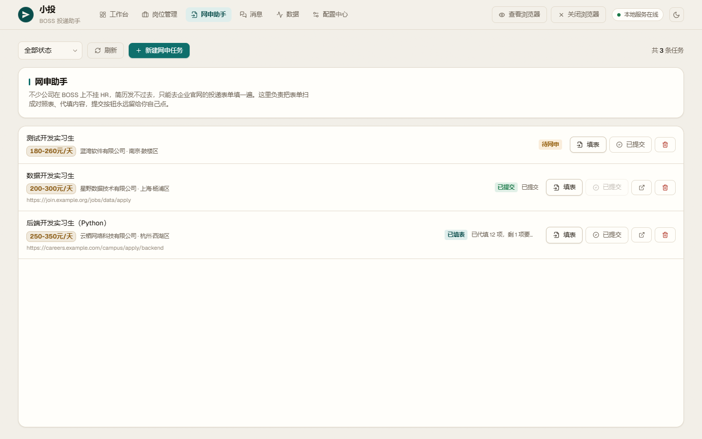

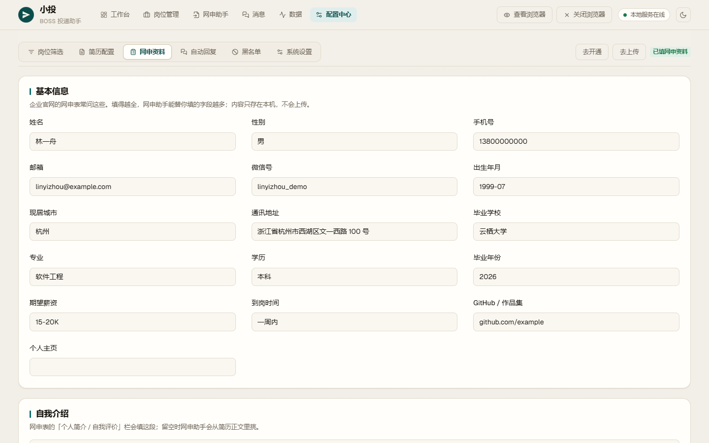

## 其他功能

### 黑名单

**配置中心 → 黑名单**里可以添加公司名或岗位关键词，命中黑名单的公司与岗位一律跳过（词条同时匹配公司名与岗位名称）。查企业判为高风险的公司会自动进榜，被「自动拉黑主动联系的 HR」拉黑的 HR 也在里面，随时可以移出。

### 顶栏：本地服务、浏览器窗口与主题

- 右上角的**本地服务状态芯片**显示与后台服务的连接状态，断开会自动重连
- **查看浏览器 / 关闭浏览器**：弹出的浏览器窗口承载登录、投递与回复，窗口被静默移出屏幕时点「查看浏览器」可以调出来；不需要在配置中心里单独开关，也可以让浏览器在后台静默运行
- **主题开关**：日间「纸与墨」与夜间「星港」一键切换，选择记在本地，刷新后保持

## 数据存放位置

所有数据都在本机项目目录下的 `user_data/`：

- `job-courier.db`：岗位、会话、配置、网申任务与网申资料等数据库
- `resumes/`：上传的简历文件
- `chrome-profile/`：Chrome 登录态
- `logs/`：运行日志，出问题先看 `user_data/logs/backend.log`

网申资料里的姓名、手机号、邮箱这些同样只写在本机数据库，不会上传到任何服务器。整个 `user_data/` 已被 `.gitignore` 排除，不会随代码一起提交；备份时直接拷贝该目录即可，想换位置可以设置环境变量 `JOB_COURIER_DATA_DIR`。

## 常见问题

**会重复投递同一个岗位吗？**
不会。看过的岗位都会记录下来，再次遇到同一个岗位（职位相同，或招聘标题、公司、HR 都相同）会直接跳过，不再重复调用 AI；之前已经沟通过的岗位也会跳过。运行日志会统计本次投递、重复和跳过的数量。「累计投递」读取的是本地岗位库里已投递的总数，重启后也会重新统计。

**为什么有岗位被跳过了？**
运行日志会写明原因，例如不符合关键词、命中黑名单、被判为骗子岗位、匹配度不足或此前已沟通。跳过的岗位同样会记进岗位管理，可以事后复盘。

**网申为什么最后一步要我自己点提交？**
企业官网的投递表单提交后不可撤回，而且大多带验证码或滑块，机器容易填错公司、投错岗位。所以网申助手只负责把字段扫出来、按你的资料代填，点提交这一步始终留给你：切到浏览器里核对一眼，自己点下去最稳妥。

**从旧数据升级后打不开岗位管理或无法投递？**
首次启动新版本时会自动补齐本地数据结构，原有配置、岗位和聊天数据全部保留；旧岗位第一次点「查企业」时会多打开一次岗位详情页查找公司。直接使用最新版本即可，不需要删库重来。

**打开后显示「小投正在启动，请稍候…」怎么办？**
这是正常现象，不用重装。每次启动都要在后台加载 AI 和数据服务，加载完成前会先显示这个遮罩，完成后自动进入工作台，一般几秒到 1 分钟，电脑配置越好越快；连接断开时会在遮罩上提示正在重连。首次启动还要构建前端，会久一点。如果等了 3 分钟以上还没进入，请查看 `user_data/logs/backend.log` 排查。


**除了 DeepSeek 还能用哪些大模型？**
任何兼容 OpenAI 接口的服务都可以，例如通义千问、Kimi、智谱、OpenAI。在 **配置中心 → 系统设置 → 大模型服务** 的「接口地址」填写该服务的地址，再填 API Key、获取模型列表即可；用本地 Ollama 时填 `http://localhost:11434/v1`，API Key 随意填写。接口地址留空就是 DeepSeek。

**每天能投多少个？**
BOSS 直聘每天约 150 次沟通上限，小投会在达到上限时自动停止，第二天继续。

**支持哪些系统？**
项目自带 Windows 启动脚本（`start-jobcourier.cmd`），已在 Windows 10 / 11 上测试；macOS 与 Linux 可以按「手动分步启动」的命令运行，同样只有一个 8000 端口。不支持 Windows 7。

**提示找不到 `uv` 或 `npm` 怎么办？**
分别安装 [uv](https://docs.astral.sh/uv/getting-started/installation/) 和 [Node.js](https://nodejs.org/) 后重开终端。如果系统里装过官网安装包的 Python，建议卸载并通过 uv 管理 Python，避免 `PYTHONHOME` / `PYTHONPATH` 之类的路径干扰。

**改了前端代码为什么不生效？**
前端是构建后由后端伺服的静态资源，改动 `frontend/` 后需要重新执行 `npm run build`（在 `frontend/` 目录）再重启服务。

## 开发者说明

后端是 FastAPI（Python 3.12），前端是手写的 React 19 + TypeScript + Vite 应用；浏览器自动化使用 Patchright，AI 能力基于 Pydantic AI，LLM 调用可选接入 OpenTelemetry 链路追踪（默认关闭，与其它配置同存在 `user_data/` 的数据库里）。

```bash
uv sync                     # 安装后端依赖

cd frontend
npm ci
npm run build               # 构建前端到 frontend/dist/

cd ..
uv run python -m job        # 启动本地服务（自动打开浏览器），等价于双击 start-jobcourier.cmd
uv run pytest -q            # 运行测试
```

前端源码在 `frontend/src/`：`Shell.tsx` 是顶栏与页面外壳，`pages/` 下依次是工作台、岗位管理、消息、数据、配置中心，样式令牌集中在 `theme.css`。前端构建产物由后端在 **8000 端口**一并伺服，所以前后端同源、只有一个端口。改动 `frontend/` 下的界面代码后需要重新执行 `npm run build` 才会生效；只改后端 `job/` 时直接重启服务即可。首次运行也可以直接双击 `start-jobcourier.cmd`，它会自动检测并补齐依赖安装与前端构建，然后启动服务。

## 许可证

本项目采用 PolyForm Noncommercial License 1.0.0（见 `LICENSE`）：个人使用、学习研究、公益与教育机构等非商业用途可以自由使用、修改和分发；**任何商业用途均不被允许**。

请合理使用，遵守 BOSS 直聘的用户协议，不要用于批量骚扰 HR 或其他损害平台与他人利益的行为。
